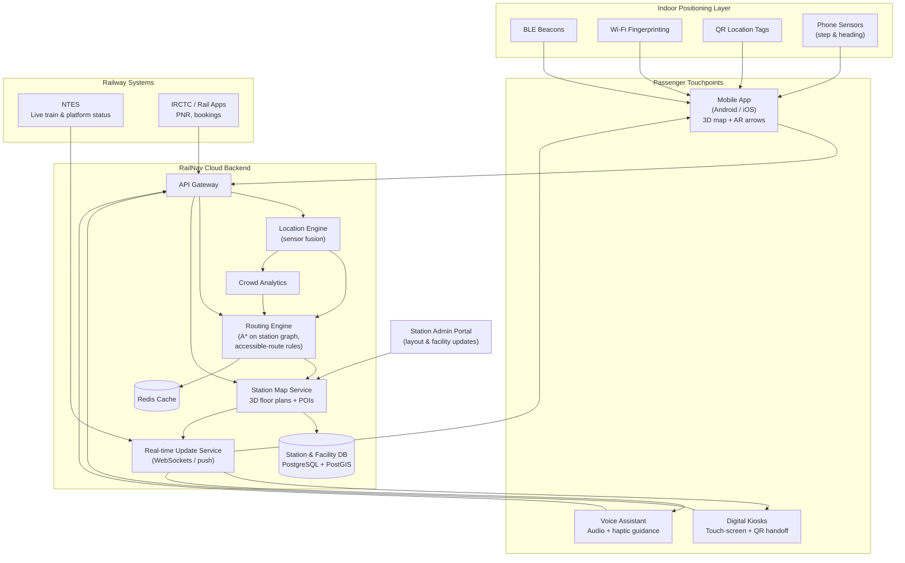
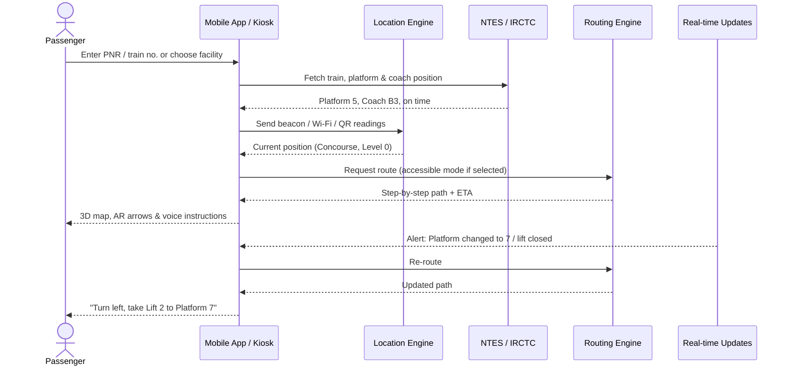
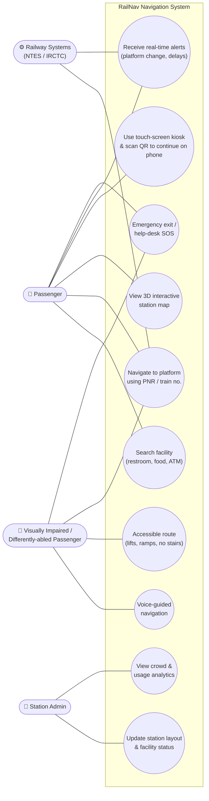

# Smart India Hackathon Workshop
## Register Number: 212224040312
## Name: A. Sherwin Infano

## Problem Title
SIH 1710: Enhancing Navigation for Railway Station Facilities and Locations

## Problem Description
**Background:** Railway stations are complex environments with numerous facilities and locations such as ticket counters, platforms, restrooms, food courts, and waiting areas. Passengers often face difficulties in navigating these spaces, especially in large or unfamiliar stations. Efficient and user-friendly navigation systems are crucial for improving passenger experience, reducing congestion, and ensuring timely travel connections.

**Description:** The problem involves developing a comprehensive navigation solution for railway stations that assists passengers in locating various facilities and destinations within the station premises. This includes creating detailed maps, providing real-time directions, and integrating features such as accessibility options for individuals with disabilities. The solution should be intuitive, easy to use, and accessible via multiple platforms, including mobile devices and digital kiosks. Key challenges include updating navigation information in real-time, ensuring accuracy, and accommodating the diverse needs of all passengers.

**Expected Solution:** The expected solution is a multi-platform navigation system that provides detailed, real-time directions to all facilities and locations within a railway station. This system should include:
- A mobile application with 3D interactive maps and step-by-step navigation.
- Digital kiosks located throughout the station with touch-screen interfaces.
- Voice-guided navigation for visually impaired passengers.
- Regular updates to reflect changes in station layout and facility locations.
- Integration with existing railway apps and services for seamless user experience.

The solution should enhance the overall passenger experience by reducing confusion, saving time, and improving accessibility within the station.

## Problem Creator's Organization
Ministry of Railway

## Idea
**RailNav – Smart Indoor Navigation for Railway Stations**

RailNav is a multi-platform indoor navigation system that guides passengers from wherever they stand in a station to any facility — platform, ticket counter, restroom, food court, waiting hall, lift, exit — with step-by-step directions.

- **Indoor positioning without GPS:** GPS does not work reliably inside stations, so RailNav locates the passenger using BLE beacons fixed across the station, Wi-Fi fingerprinting, and QR codes at pillars and entrances as a zero-cost fallback.
- **One map, many screens:** A single digital model of each station (3D floor plans + a graph of walkable paths) is shared by the mobile app, touch-screen kiosks, and the voice assistant, so every channel shows the same up-to-date information.
- **Train-aware routing:** The passenger enters a PNR or train number; RailNav pulls live platform and delay data from railway systems (NTES / IRCTC) and routes them straight to the right platform and coach position, re-routing automatically if the platform changes.
- **Accessibility first:** An "accessible route" mode avoids stairs and uses lifts, ramps and escalators; a voice-guided mode with haptic cues serves visually impaired passengers; the UI supports Hindi, English and regional languages.
- **Live updates by station staff:** An admin web portal lets station managers mark a restroom closed, an escalator under maintenance, or a new food stall, and the change reaches every app and kiosk instantly.
- **Crowd-aware paths:** Anonymous beacon density data shows congested zones, so routes can steer passengers around crowded foot-over-bridges.

## Proposed Solution / Architecture Diagram

### How it works – Navigation Flow

## Use Cases

| # | Use Case | Actor | Description |
|---|----------|-------|-------------|
| 1 | Search facility | Passenger | Search or browse categories (restrooms, food courts, ATMs, cloak room, waiting hall) and get the nearest one with walking time. |
| 2 | Navigate to platform | Passenger, Railway Systems | Enter PNR or train number; the app fetches live platform and coach position and guides the passenger to the exact boarding point. |
| 3 | 3D interactive map | Passenger | Explore multi-level station maps, zoom, rotate, and switch floors / foot-over-bridges. |
| 4 | Kiosk navigation | Passenger | Passengers without smartphones use touch-screen kiosks; a QR code lets smartphone users continue the same route on their phone. |
| 5 | Voice-guided navigation | Visually impaired passenger | Turn-by-turn audio instructions with vibration cues and landmark announcements ("tactile path ahead, lift on your right"). |
| 6 | Accessible routing | Differently-abled / elderly passenger | Routes avoid stairs and use lifts, ramps and escalators; wheelchair and battery-car points are shown. |
| 7 | Real-time alerts | Passenger, Railway Systems | Push notifications for platform changes, delays, closed facilities, and automatic re-routing. |
| 8 | Update layout & facilities | Station Admin | Mark facilities open/closed, add new stalls, block paths under maintenance; changes sync to all apps and kiosks instantly. |
| 9 | Crowd & usage analytics | Station Admin | Heat maps of footfall and most-searched facilities to plan staffing and reduce congestion. |
| 10 | Emergency & help | Passenger | One-tap route to nearest exit, RPF / help desk, or medical room; share live location with station staff. |

## Technology Stack

| Layer | Technologies |
|-------|-------------|
| Mobile App | Flutter (Android & iOS), ARCore / ARKit for AR arrows, Flutter TTS & speech-to-text for voice mode |
| 3D Maps | Unity / Three.js for 3D station models, Mapbox GL / IndoorAtlas-style indoor map rendering |
| Kiosk | React web app in kiosk mode on touch-screen displays (Electron), on-screen multilingual keyboard |
| Indoor Positioning | BLE beacons (iBeacon / Eddystone), Wi-Fi RSSI fingerprinting, QR location tags, pedestrian dead reckoning (phone accelerometer + gyroscope) |
| Backend | Node.js (Express) / Python (FastAPI) microservices, WebSockets for live updates |
| Routing | A* / Dijkstra on a station graph (nodes = junctions, edges = walkable paths with stairs/lift attributes) |
| Database | PostgreSQL + PostGIS (spatial data), Redis (caching, live state) |
| Admin Portal | React + Tailwind CSS, map editor for floor plans and POIs |
| Integrations | NTES (live train status), IRCTC / RailOne APIs (PNR), Firebase Cloud Messaging (push alerts) |
| Cloud & DevOps | Docker, Kubernetes, AWS / MeghRaj (GoI cloud), GitHub Actions CI/CD |
| Languages | Hindi, English + regional languages via i18n (Bhashini API for translation & speech) |

## Dependencies

**Hardware**
- BLE beacons installed at junctions, platforms, stairs, lifts and facility entrances (approx. every 10–15 m).
- Touch-screen kiosks at entrances, concourse and foot-over-bridges.
- QR location tags on pillars and signboards.
- Station Wi-Fi (RailTel / RailWire) for positioning and data.

**Data**
- Digitised floor plans / CAD drawings of each station from Indian Railways.
- Facility (POI) list with locations, timings and accessibility attributes.
- Access to NTES and IRCTC APIs for live train, platform and PNR data.

**Software Libraries**
- `flutter`, `flutter_blue_plus`, `flutter_tts`, `speech_to_text`, `ar_flutter_plugin`
- `three.js` / Unity, `mapbox-gl`
- `express` / `fastapi`, `socket.io`, `pg`, `postgis`, `redis`
- `firebase-admin` (push notifications)

**Stakeholders**
- Ministry of Railways / zonal railway station management for approvals and map data.
- RailTel for network infrastructure.
- Accessibility organisations for testing voice and accessible-route modes.
